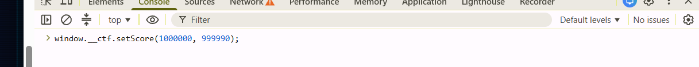

# CTF Writeup: Galactic Invaders v2.1

**Platform/URL:** galactic-invaders.infosec.online[cite: 2]
**Category:** Web Exploitation
**Difficulty:** Easy
**Author:** [Tên của bạn]

---

## 1. Overview (Tổng quan)
* **Tên thử thách:** Ứng dụng web mang tên "Galactic Invaders v2.1"[cite: 2, 4].
* **URL:** Trò chơi được lưu trữ tại tên miền `galactic-invaders.infosec.online`[cite: 2, 5].
* **Mô tả:** Giao diện là một trò chơi bắn tàu vũ trụ, trong đó người chơi cần bảo vệ Trạm Alpha (Station Alpha)[cite: 3, 4].
* **Mục tiêu:** Giao diện trò chơi yêu cầu người chơi phải đạt được mục tiêu điểm số là 1.000.000 (1,000,000 PTS)[cite: 3, 4].

## 2. Analysis (Phân tích)
* Tại màn hình chính của trò chơi, tôi đã bấm vào chức năng bắt đầu chơi[cite: 2].
* Khi vào màn hình trò chơi, tôi đã sử dụng tính năng xem mã nguồn (view-source) của trình duyệt để kiểm tra cấu trúc trang web tại đường dẫn `/game`[cite: 4].
* Trong mã nguồn HTML, tôi phát hiện một tệp JavaScript được gọi vào trang thông qua đường dẫn `/static/game.js?v=2.2`[cite: 4].
* Mở trực tiếp tệp JavaScript này và lướt xuống dưới, tôi phát hiện một đoạn mã kiểm tra điều kiện chiến thắng bên trong hàm `checkFlag()`[cite: 5].
* Hàm này giải mã một biến `hidden` từ chuỗi Base64 bằng lệnh `atob("YW50aWNoZWF0Q2hlY2s=")`[cite: 5].
* Để hàm gọi tiếp đến chức năng hiển thị cờ `secureFlagDisplay()`, điểm số phải thỏa mãn điều kiện `score > 999999` và `score == (previousScore + 10)`[cite: 5].
* Tôi nhận thấy lập trình viên đã gán một object `__ctf` vào đối tượng toàn cục `window` thông qua câu lệnh `window.__ctf`[cite: 5].
* Object này cung cấp sẵn hàm `setScore(s, p)` để thay đổi biến `score` và `previousScore`[cite: 5].
* Object cũng cung cấp hàm `triggerCheck()` để gọi trực tiếp lệnh kiểm tra cờ[cite: 5].

## 3. Vulnerability (Lỗ hổng)
* **Loại lỗ hổng:** Insecure Client-Side Trust (Tin tưởng dữ liệu máy khách không an toàn) & Global Scope Exposure (Phơi bày biến toàn cục).
* **Phân tích:** Ứng dụng web đã mắc sai lầm nghiêm trọng khi xử lý logic tính điểm và xác thực người thắng cuộc trực tiếp bằng JavaScript trên trình duyệt của người dùng. Việc đưa object `__ctf` ra môi trường `window` cho phép bất kỳ ai mở Developer Tools đều có quyền gọi các hàm thiết lập điểm số, qua đó dễ dàng vượt qua điều kiện kiểm tra (anticheat) mà không cần thực sự chơi game để đạt 1.000.000 điểm.

## 4. Exploitation (Khai thác/PoC)
**Bước 1:** Ngay tại màn hình trò chơi, nhấn F12 để mở Developer Tools và chuyển sang tab **Console**.
**Bước 2:** Gọi hàm `setScore` đã bị lộ để thiết lập mức điểm số giả mạo. Để vượt qua điều kiện `score > 999999` và khoảng cách điểm là 10, tôi nhập lệnh:
```javascript
window.__ctf.setScore(1000000, 999990);


